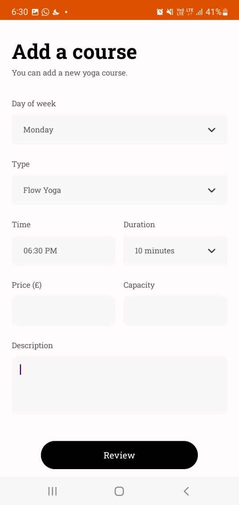
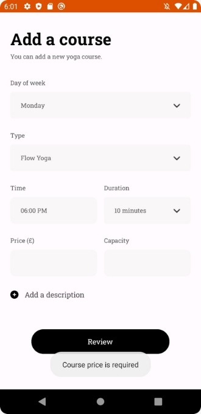
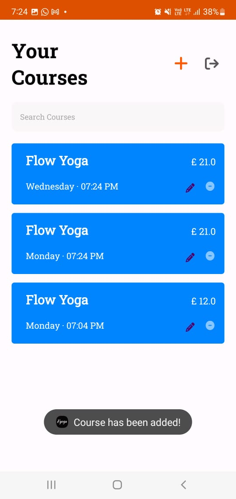
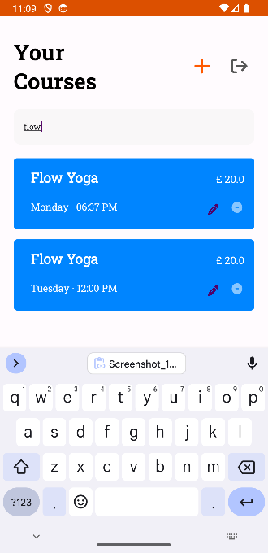
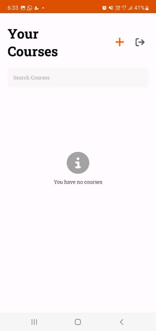
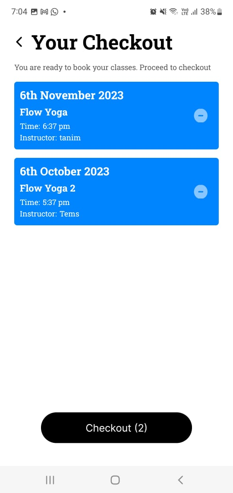
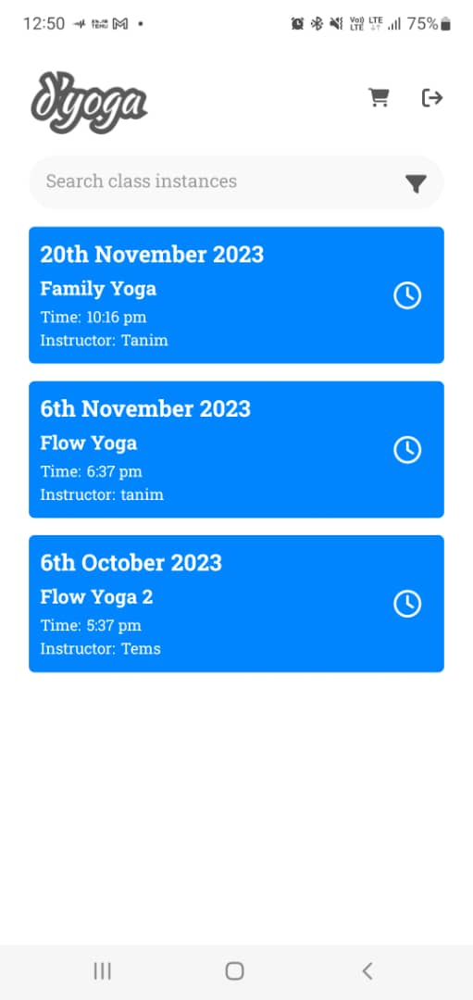
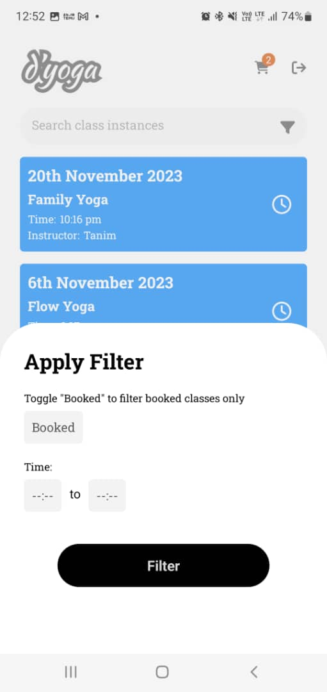
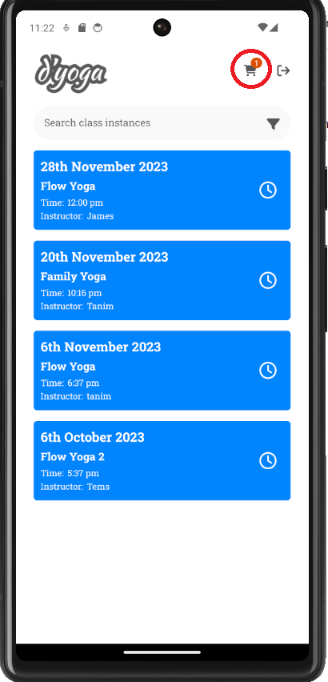
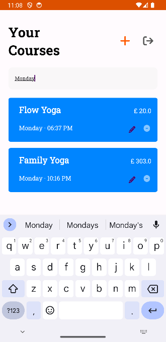

# Yoga App (d’Yoga)

The Yoga App is a mobile application for managing and booking yoga classes.  
It consists of two connected applications:

- **Admin App** – for creating and managing yoga courses and class schedules  
- **Customer App** – for browsing, filtering, booking, and checking out yoga classes  

The project is built using **Android (Java)** and **React Native**, with **Firebase** handling authentication and cloud data synchronization.

---

## Screenshots

### Admin App

  
  
  

  
  
  

**Admin features shown:**  
Course creation, validation, course listing, search functionality, and empty state handling.

---

### Customer App

  
  
  

  

**Customer features shown:**  
Class browsing, filtering, adding to cart, and checkout flow.

---

## Technology Used

- Android (Java) – Admin application  
- React Native (Expo) – Customer application  
- Firebase Authentication  
- Firebase Firestore (Cloud Database)

---

## Installation

The repository contains two main folders:

1.
